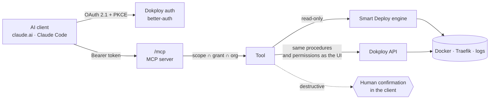

<div align="center">

# Dokploy · Smart Deploy + MCP

**Your self-hosted PaaS explains why a deployment fails, fixes it in one click,
and can be driven by AI agents, safely.**

[](https://github.com/im-sacha-cohen/dokploy/actions/workflows/fork-image.yml)
[](LICENSE.MD)
[](https://github.com/Dokploy/dokploy)
[](docs/MCP_ARCHITECTURE.md)

</div>

> **Unofficial fork** of [Dokploy](https://github.com/Dokploy/dokploy), the
> open-source alternative to Vercel, Heroku and Netlify. Everything Dokploy
> does still works the same way; this fork adds the features below on top.

---

## What this fork adds

### 🩺 Smart Deploy: a diagnosis for every service

A deterministic engine (no AI involved) reads Docker, Traefik and the logs, and
tells you **why** something does not work. It names the root cause, shows the
evidence and offers the fix.

- **Applications, compose stacks and databases** (Postgres, MySQL, MariaDB,
  Mongo, Redis) each get a status banner and a Smart Deploy tab.
- **Detects**:
  - wrong domain port, app listening on `localhost` only, nothing listening;
  - crash loops, missing environment variables, failing healthchecks;
  - image not found, out of memory, disk full;
  - database data written by another major version;
  - external port already taken, config changed but not deployed, stopped
    services;
  - build failures, and an image that is not the one last deployed.
- **Links causes to consequences**: a 502 caused by a wrong port shows the
  wrong port, not the 502.
- **One-click fixes**, always confirmed and re-validated against a fresh
  diagnosis: use the right port, deploy the latest commit, roll back to a kept
  image, start or redeploy a service.
- **Network path**: domain → Traefik → routed port → container, each hop
  checked for real.
- **Version tracking for applications**: the commit really running, proven by
  its image, compared with the branch head. The last 5 images are kept for
  instant rollback.

### 🤖 Native MCP server: let AI agents operate Dokploy

Connect Claude (claude.ai, Claude Code) or any MCP client to
`https://<your-panel>/mcp`.

- **OAuth 2.1** on Dokploy's existing accounts (PKCE, dynamic registration,
  audience-bound short-lived tokens, instant revocation), with a consent screen.
- **53 tools** cover the whole platform: projects, services, deployments, logs,
  Smart Deploy, environment variables, domains and DNS, backups, monitoring,
  and container commands.
- **Same permissions as the UI**: tools call Dokploy's own API procedures, from
  an allowlist.
- **Opt-in power**: environment variables, create/delete and commands are off
  until an admin enables them.
- **Human in the loop**: deletions, stops, restores and every container command
  ask for a confirmation in the client. The confirmation is HMAC-sealed to the
  exact call.

### 🌐 DNS records from the domain form

With a DNS provider connected (Cloudflare, Route 53, OVH, Infomaniak, Porkbun),
adding a domain suggests a free subdomain and creates the A record together
with the domain. Nothing is ever overwritten, and the record can be deleted
with the domain.

### 📈 Monitoring through MCP

Server health (RAM, CPU, disk, Docker network pools, daemon errors), Docker disk
usage, live stats of any service and the monitoring agent's history, all
readable by agents.

---

## Quick install

On a Linux server (Ubuntu 22.04 or 24.04, **amd64 or arm64**), as root:

```bash
curl -sSL https://raw.githubusercontent.com/im-sacha-cohen/dokploy/feat/smart-deploy-mcp/scripts/install-fork.sh \
  | sudo bash -s -- --domain panel.example.com
```

- **No Dokploy yet**: the official installer runs first, then the server
  switches to this fork.
- **Dokploy already installed**: the database and `/etc/dokploy` are backed
  up, then the server switches. If the fork does not start, the script goes
  back to the previous image by itself.
- `--domain` is the panel's HTTPS host. It enables `/mcp` at
  `https://<domain>/mcp`.

Roll back to the official image at any time:

```bash
curl -sSL https://raw.githubusercontent.com/im-sacha-cohen/dokploy/feat/smart-deploy-mcp/scripts/install-fork.sh \
  | sudo bash -s -- --rollback
```

The multi-arch image (`ghcr.io/im-sacha-cohen/dokploy:smart-deploy`) is built
by GitHub Actions on every push, and is smoke-tested before it is published.
Manual steps, updates and rollback details:
[docs/INSTALL_FORK.md](docs/INSTALL_FORK.md).

> ⚠️ Do not use Dokploy's built-in **Update** button: it reinstalls the official
> image. Re-run the install command instead.

---

## Connect an AI client

1. In **Settings › AI Integrations**, enable the integration and choose what
   clients may request.
2. Add the server to your client:
   - **claude.ai**: Settings › Connectors › Add custom connector, with
     `https://panel.example.com/mcp`.
   - **Claude Code**:

     ```bash
     claude mcp add --transport http dokploy https://panel.example.com/mcp
     ```

3. Sign in to Dokploy, tick the permissions on the consent screen, and ask
   away:

> *"Why does my app `api` return a 502?"* ·
> *"Deploy Twenty CRM on twenty.example.com with a Postgres database."* ·
> *"Which service uses the most memory, and how full is the disk?"* ·
> *"Roll back `web` to its previous deployment."*

### Scopes and tools

| Scope | Default | Tools |
|---|---|---|
| `mcp:read` | on | list projects, services and servers; service details; deployments, status, build and runtime logs; Smart Deploy diagnosis, preflight and timeline; health, ports, version; subdomain suggestion; backup files; server health, disk usage, service stats, metrics history (**23**) |
| `mcp:deploy` | on | deploy, deploy latest, rebuild, restart, roll back, start, cancel, apply a Smart Deploy fix (**9**) |
| `mcp:config` | on | service settings, source (Git, Docker image, GitHub), build type, compose file, domains (with DNS record), port, healthcheck (**9**) |
| `mcp:env` | off | read variables (secrets masked), set or remove variables (**2**) |
| `mcp:manage` | off | create and delete projects, environments and services; stop; run and restore backups (**9**) |
| `mcp:exec` | off | run a command inside a service's container, confirmed every time (**1**) |

Full reference: [docs/MCP_ARCHITECTURE.md](docs/MCP_ARCHITECTURE.md).

---

## How it works



**Effective permission** = token scopes ∩ consented scopes ∩ scopes the
organization allows ∩ the user's Dokploy permissions. All four are checked on
every request.

Security model, threats and limits: [docs/MCP_SECURITY.md](docs/MCP_SECURITY.md).

---

## Documentation

| Topic | Document |
|---|---|
| Install on a server, update, roll back | [INSTALL_FORK.md](docs/INSTALL_FORK.md) |
| Diagnostic rules and how facts are collected | [DEPLOYMENT_DIAGNOSTICS.md](docs/DEPLOYMENT_DIAGNOSTICS.md) |
| Version tracking, wizard, fixes | [SMART_DEPLOY_ENGINE.md](docs/SMART_DEPLOY_ENGINE.md) |
| MCP server, tools, OAuth flow | [MCP_ARCHITECTURE.md](docs/MCP_ARCHITECTURE.md) |
| MCP security model | [MCP_SECURITY.md](docs/MCP_SECURITY.md) |
| Local development (Docker-in-Docker devbox, demo apps) | [LOCAL_DEVELOPMENT.md](docs/LOCAL_DEVELOPMENT.md) |
| What was tested, and what was not | [TESTING.md](docs/TESTING.md) |
| Architecture audit of upstream Dokploy | [ARCHITECTURE_AUDIT.md](docs/ARCHITECTURE_AUDIT.md) |
| Changelog | [IMPLEMENTATION_PROGRESS.md](docs/IMPLEMENTATION_PROGRESS.md) |

---

## Development

Everything runs in an isolated **Docker-in-Docker devbox**, with its own Swarm,
Traefik and demo services broken on purpose. Your own containers are never
touched.

```bash
docker exec dokploy-devbox sh -c 'cd /workspace/apps/dokploy && npx vitest run --config __test__/vitest.config.ts __test__/smart-deploy'
```

End-to-end scenarios against the local instance:

```bash
node dev/demo-apps/diagnose.mjs                # applications A–G
node dev/demo-apps/diagnose-services.mjs       # databases and compose stacks, fixes applied for real
node dev/mcp/oauth-mcp-e2e.mjs                 # OAuth 2.1 + MCP security
node dev/mcp/platform-e2e.mjs                  # the whole platform through MCP
bash dev/phase7/run-all.sh                     # everything, including permissions and isolation
```

Setup and troubleshooting: [docs/LOCAL_DEVELOPMENT.md](docs/LOCAL_DEVELOPMENT.md).

**Design rules**:
- additive changes only: upstream procedures are called, never rewritten;
- additive migrations;
- no secret ever returned;
- read-only diagnostics;
- every fix confirmed and re-validated;
- no test result reported unless it was actually run.

---

## Status

This fork is young. It is tested extensively on the local devbox (unit tests,
real end-to-end scenarios, permission and isolation tests: see
[TESTING.md](docs/TESTING.md)), and it runs on a first real ARM server. Some
paths are still to be proven on real infrastructure, such as backups to S3,
real DNS record creation, and the monitoring agent's history. Try it on a
non-critical server first.

---

## Credits and license

Built on [Dokploy](https://github.com/Dokploy/dokploy) by Mauricio Siu and its
contributors. Please support the original project:
[docs.dokploy.com](https://docs.dokploy.com) ·
[GitHub Sponsors](https://github.com/sponsors/Siumauricio) ·
[Discord](https://discord.gg/2tBnJ3jDJc).

Licensed like upstream: [Apache License 2.0](LICENSE.MD), except the
`/proprietary` directories ([LICENSE_PROPRIETARY.md](LICENSE_PROPRIETARY.md)),
which this fork does not modify. "Dokploy" is the name of the upstream project;
this fork is not affiliated with or endorsed by Dokploy Technology, Inc.
